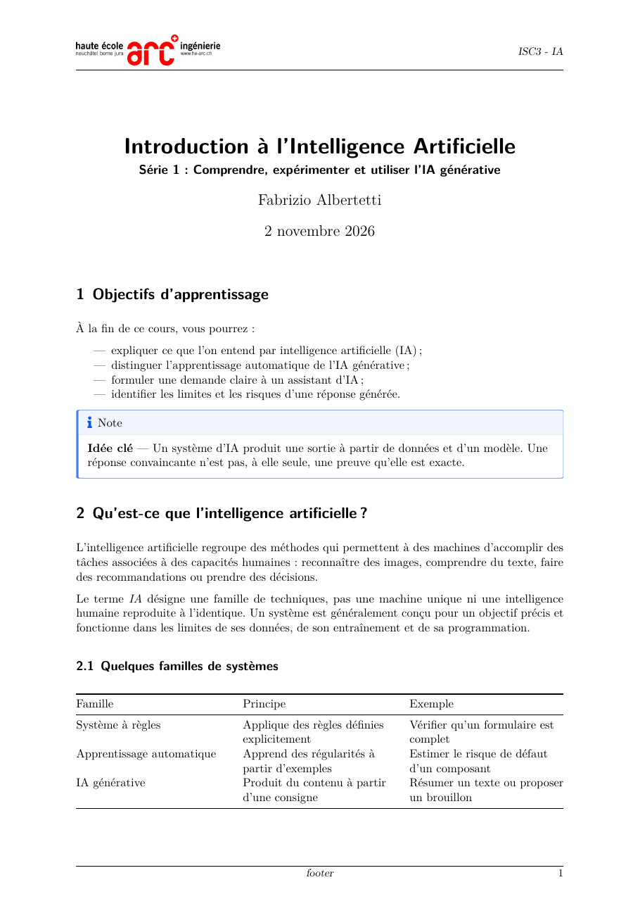

# Extension Quarto : thème de séries/devoirs HE-Arc Ingénierie (PDF)


Extension de format Quarto pour produire des supports de cours PDF au format
A4 avec la classe LaTeX `scrartcl`, une numérotation des sections et l’en-tête
avec le logo, la classe et le cours. Le pied de page peut afficher un texte
configurable et conserve la pagination.

## Prérequis

- [Quarto](https://quarto.org/docs/get-started/)
- Une distribution LaTeX compatible avec Quarto, par exemple TinyTeX ou MiKTeX
- La classe KOMA-Script (`scrartcl`), généralement fournie avec la distribution
  LaTeX

## Utiliser l’exemple de ce dépôt

Le dépôt contient les sources de l’extension dans
`_extensions/theme-hearc-assignments/`. L’exemple
[`example/serie_01.qmd`](example/serie_01.qmd) utilise cette copie
locale et ses illustrations dans `example/images/`. Depuis la racine du dépôt,
générez son PDF avec :

```sh
quarto render example/serie_01.qmd
```

Le résultat est créé dans `_output/example/serie_01.pdf`. Le dossier
`_output/` est configuré comme répertoire de rendu dans `_quarto.yml`; Quarto
conserve dans ce dossier le chemin relatif du document source.

### Aperçu du rendu



## Installer l’extension depuis GitHub

Dans le dossier de votre projet Quarto, installez l’extension publiée dans
ce dépôt GitHub :

```sh
quarto add fabrizioalbertetti/quarto_theme_hearc_assignments/extension
```

Cette commande télécharge l’extension dans le dossier `_extensions` du
projet. Elle doit être exécutée une fois par projet, puis à nouveau pour
mettre à jour l’extension. Sélectionnez ensuite le format
`theme-hearc-assignments-pdf` dans le front matter de votre document :

```yaml
---
course:
  class: "ISC3"
  short: "IA"
  footer: "Support de cours"

title: "Titre du cours"
subtitle: "Sous-titre"
author: "Nom de l’enseignant·e"
date: today
lang: fr
format:
  theme-hearc-assignments-pdf:
    toc: true
    toc-depth: 2
---
```

Le format affiche `course.class - course.short` dans l’en-tête et `course.footer`
dans le pied de page. Ces valeurs doivent être définies dans le `_quarto.yml`
du projet ou les métadonnées du document.

Rendez ensuite le document avec :

```sh
quarto render mon-cours.qmd
```

La date et les options du format peuvent être adaptées dans le front matter.
Les options Quarto définies sur le document remplacent les valeurs par défaut
de l’extension.

Pour enregistrer également le rendu d’un projet utilisant l’extension dans un
dossier `_output`, définissez ce dossier dans le `_quarto.yml` du projet :

```yaml
project:
  output-dir: _output
```

## Diagrammes draw.io

Les fichiers `.drawio.svg` (et `.drawio`) peuvent être inclus directement,
sans export préalable :

```markdown
{#fig-schema width=90%}
```

Au rendu PDF, le filtre `drawio.lua` de l’extension exporte le diagramme en
PDF vectoriel (recadré) avec le CLI de [draw.io Desktop](https://www.drawio.com),
qui doit donc être installé. `rsvg-convert` n’est pas nécessaire. L’exécutable
est détecté automatiquement (emplacements d’installation usuels sous Windows,
macOS et Linux) ; sinon, indiquez son chemin dans la variable d’environnement
`DRAWIO_CMD`.

Les exports sont mis en cache dans `.drawio-cache/` (à ignorer dans Git) et ne
sont refaits que si le diagramme a été modifié.

## Code source depuis un fichier

Pour afficher un fichier de code sans le recopier dans le `.qmd`, laissez un
bloc de code vide et indiquez le fichier avec l’attribut `include` (chemin
relatif au document) :

````markdown
```{.python include="code/classifieur_spam.py" filename="classifieur_spam.py"}
```
````

Pour n’afficher qu’un extrait, ajoutez `start-line` et `end-line`. Avec
`.numberLines`, la numérotation reprend celle du fichier :

````markdown
```{.python include="code/classifieur_spam.py" start-line=6 end-line=12 .numberLines}
```
````

Le code est seulement affiché, sans être exécuté. Il n’est donc pas
nécessaire d’installer Python ou Jupyter. La classe du bloc (`.python`,
`.java`, `.c`, …) détermine la coloration syntaxique. Le filtre
`include-code.lua` fait ce remplacement. Voir l’exemple dans
[`example/serie_01.qmd`](example/serie_01.qmd).

## Contenu de l’extension

- `_extension.yml` définit le format PDF `theme-hearc-assignments-pdf` et ses
  options par défaut.
- `before-title.tex` configure l’en-tête et le pied de page avec
  `scrlayer-scrpage` et les métadonnées du cours.
- `drawio.lua` convertit à la volée les diagrammes draw.io inclus comme images.
- `include-code.lua` remplit les blocs de code `include="..."` avec le contenu
  du fichier indiqué.
- `logo-he-arc-ing.jpg` est copié dans le dossier du document lors du rendu,
  afin que le PDF puisse utiliser le logo.

Le format conserve les fonctionnalités PDF de Quarto, notamment les tables,
les images, les références croisées et les bibliographies.
