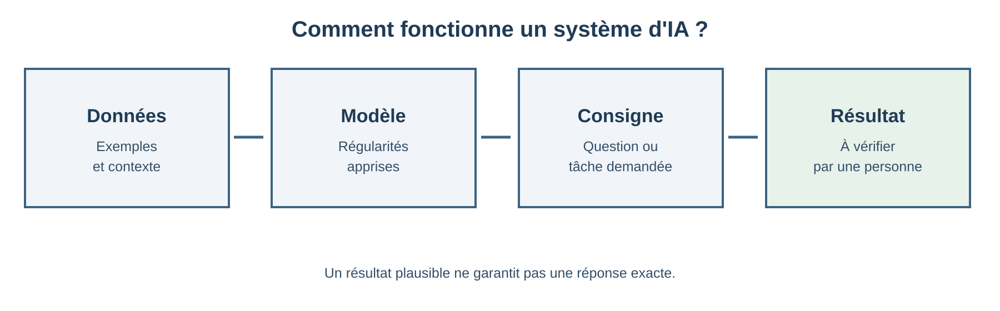
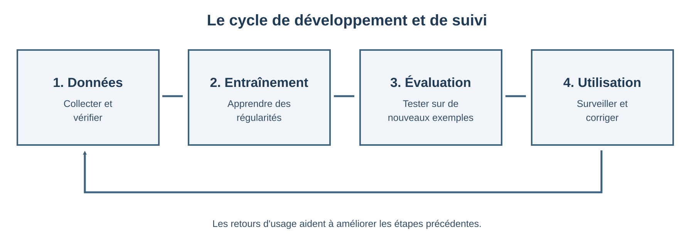

# Objectifs d’apprentissage

À la fin de ce cours, vous pourrez :

- expliquer ce que l’on entend par intelligence artificielle (IA) ;
- distinguer l’apprentissage automatique de l’IA générative ;
- formuler une demande claire à un assistant d’IA ;
- identifier les limites et les risques d’une réponse générée.

::: {.callout-note}
**Idée clé** — Un système d’IA produit une sortie à partir de données et d’un
modèle. Une réponse convaincante n’est pas, à elle seule, une preuve qu’elle
est exacte.
:::

# Qu’est-ce que l’intelligence artificielle ?

L’intelligence artificielle regroupe des méthodes qui permettent à des
machines d’accomplir des tâches associées à des capacités humaines :
reconnaître des images, comprendre du texte, faire des recommandations ou
prendre des décisions.

Le terme *IA* désigne une famille de techniques, pas une machine unique ni une
intelligence humaine reproduite à l’identique. Un système est généralement
conçu pour un objectif précis et fonctionne dans les limites de ses données,
de son entraînement et de sa programmation.

{#fig-fonctionnement width=95%}

## Quelques familles de systèmes

| Famille | Principe | Exemple |
|:--|:--|:--|
| Système à règles | Applique des règles définies explicitement | Vérifier qu’un formulaire est complet |
| Apprentissage automatique | Apprend des régularités à partir d’exemples | Estimer le risque de défaut d’un composant |
| IA générative | Produit du contenu à partir d’une consigne | Résumer un texte ou proposer un brouillon |

# De l’apprentissage automatique à l’IA générative

L’apprentissage automatique (*machine learning*) ajuste un modèle à partir
d’exemples. Il peut, par exemple, apprendre à classer des messages comme
indésirables ou non indésirables.

L’apprentissage profond (*deep learning*) est une famille de méthodes fondées
sur des réseaux de neurones comportant de nombreuses couches. Les grands
modèles de langage (LLM) utilisent ces méthodes pour traiter et générer du
texte. Ils calculent des suites de mots plausibles à partir du contexte et de
leur entraînement ; ils ne consultent pas nécessairement une source fiable et
à jour.

## Entraîner et utiliser un modèle

On peut résumer le cycle de vie d’un système d’apprentissage en quatre étapes :

1. **Collecter des données** pertinentes pour la tâche et vérifier leur
   qualité.
2. **Entraîner le modèle** afin qu’il apprenne des régularités dans ces
   exemples.
3. **Évaluer le modèle** sur des données différentes de celles utilisées pour
   l’entraînement.
4. **Utiliser et surveiller le système** dans son contexte réel, en corrigeant
   les erreurs constatées.

Des données incomplètes ou biaisées peuvent conduire à des résultats
incomplets ou biaisés. Une bonne performance moyenne ne garantit pas non plus
un résultat correct dans chaque situation.

{#fig-cycle width=95%}

# Bien dialoguer avec une IA générative

Une consigne, ou *prompt*, gagne à préciser le contexte, la tâche, les
contraintes et le format attendu. On peut ensuite vérifier la réponse et
affiner la consigne.

::: {.callout-tip}
**Exemple de consigne**

> Tu es un assistant pédagogique. Résume le texte ci-dessous en cinq points
> pour des étudiant·es de première année. Utilise uniquement les informations
> du texte, signale les incertitudes et termine par deux questions de
> révision. Texte : […]
:::

Cette structure fournit un objectif et des critères de sortie, mais elle ne
garantit pas que le résultat sera exact. Il faut relire, recouper et corriger
la réponse avant de l’utiliser.

## Une méthode de vérification

Pour toute réponse importante :

1. repérez les affirmations factuelles et les chiffres ;
2. vérifiez-les à l’aide de sources fiables et indépendantes ;
3. contrôlez que la réponse répond bien à la question posée ;
4. signalez les limites et conservez la responsabilité de la décision.

# Limites et responsabilité

Les modèles génératifs peuvent produire des erreurs plausibles, parfois
appelées *hallucinations*. Ils peuvent aussi reproduire des biais présents
dans les données, manquer de contexte ou divulguer des informations saisies
dans un service externe.

Avant d’utiliser un outil d’IA, demandez-vous :

- **Fiabilité :** puis-je vérifier les éléments importants ?
- **Confidentialité :** suis-je autorisé·e à transmettre ces données ?
- **Équité :** le résultat désavantage-t-il certains groupes ?
- **Responsabilité :** qui valide le résultat et répond de la décision ?

::: {.callout-warning}
Ne saisissez pas de données personnelles, confidentielles ou sensibles dans
un outil sans avoir vérifié les règles de l’institution et les conditions du
service utilisé.
:::

# Activité : évaluer une réponse générée

En petits groupes, demandez à un assistant d’IA de proposer un résumé d’un
court texte de cours. Comparez ensuite le résumé à la source :

1. Quelles idées essentielles ont été conservées ou omises ?
2. Des affirmations ont-elles été ajoutées sans appui dans le texte ?
3. Quelles vérifications seraient nécessaires avant de partager ce résumé ?

Terminez en réécrivant la consigne pour mieux cadrer le public, la longueur et
les éléments à vérifier.

# À retenir

- L’IA recouvre des approches diverses, conçues pour des tâches et des
  contextes spécifiques.
- L’IA générative produit des réponses plausibles, mais celles-ci doivent
  être vérifiées.
- Une consigne précise aide à obtenir une réponse utile sans garantir sa
  qualité.
- L’usage responsable implique de protéger les données, de considérer les
  biais et de garder une validation humaine.
